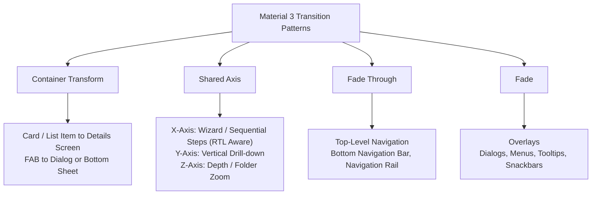

# Material Design 3 (M3) Motion Design System Skill

This skill provides complete architectural guidelines, token specifications, cubic-bezier conversions, transition patterns, and Flutter implementation patterns for **Material Design 3 Motion**.

All animation, transition, and micro-interaction code in `delegate_app` MUST strictly adhere to these specifications.

> **Design system (TAS-345, 2026-11-26):** the app's design references are now `docs/design/` (m3-kit). For new work use the motion tokens in `lib/core/design/motion.dart` (`TashilSpring` for movement inside a screen, `TashilEasing` for transitions, `TashilTransitions`), described in `docs/design/design-system.md` (Motion). The `AppMotion*` tokens below stay valid where existing code uses them, and every route keeps one transition (`M3PageTransitionsBuilder` / `AppMotionPage`). Both follow the same M3 values.

---

## 1. Core Principles of Material 3 Motion

Motion in Material Design 3 is designed to make user interfaces expressive, intuitive, and physically grounded.

### 1.1 The Two Motion Schemes
1. **Expressive Scheme**:
   - **Characteristics**: Energetic, personality-driven, enthusiastic, natural bounce.
   - **Physics**: Employs slight overshoot ($\text{damping} < 1.0$) on spatial movement.
   - **Primary Use Cases**: Hero transitions, Floating Action Buttons (FABs), badge reveals, delightful feedback, onboarding milestones.
2. **Standard Scheme**:
   - **Characteristics**: Clean, functional, efficient, unobtrusive, minimal to zero overshoot.
   - **Physics**: Critically damped or near-critically damped ($\text{damping} \ge 0.9$).
   - **Primary Use Cases**: High-frequency utility workflows, form inputs, search dropdowns, dense administrative dashboards, table row sorting.

### 1.2 Separation of Spatial Motion vs. Effects
- **Spatial Motion (Movement, Size, Shape, Bounds)**:
  - Objects in the real world have mass and momentum. Spatial motion uses curved acceleration/deceleration and spring physics with slight overshoot in the Expressive scheme.
- **Effects (Opacity, Surface Color Tint, Elevation Shadow)**:
  - Colors and opacity do NOT have physical mass.
  - **CRITICAL RULE**: Effects MUST NEVER overshoot. They must always use monotonic curves or critically damped springs ($\text{damping} = 1.0$). Overshooting opacity (e.g. going above 1.0 or bouncing back) produces unnatural flashing and visual glitches.

### 1.3 The Exit < Enter Rule
- **Entering UI Elements**: Need more time (~400ms - 500ms) so users can comprehend new information coming into view.
- **Exiting UI Elements**: Must be fast (~150ms - 200ms, typically 50% of entrance time). The user has completed their action and should not be kept waiting for dismissals to finish.

---

## 2. Motion Physics: Springs to Cubic-Bezier Curves Matrix

Material 3 natively models motion with physical springs (damping $\zeta$ and stiffness $k$). For web and Flutter standard animations where cubic-bezier curves are used, Google specifies the exact conversions below:

### 2.1 Spatial Curves (Position, Bounds, Translation, Scale)

| Token Name | Spring Damping ($\zeta$) | Spring Stiffness ($k$) | Cubic-Bezier Curve (Flutter / CSS) | Duration |
| :--- | :--- | :--- | :--- | :--- |
| **Expressive Fast Spatial** | `0.6` | `800.0` | `Cubic(0.43, 1.47, 0.21, 0.90)` | `350ms` |
| **Expressive Default Spatial** | `0.8` | `380.0` | `Cubic(0.38, 1.21, 0.22, 1.00)` | `500ms` |
| **Expressive Slow Spatial** | `0.8` | `200.0` | `Cubic(0.39, 1.19, 0.18, 0.99)` | `650ms` |
| **Standard Fast Spatial** | `0.9` | `1400.0` | `Cubic(0.22, 1.00, 0.41, 1.00)` | `350ms` |
| **Standard Default Spatial** | `0.9` | `700.0` | `Cubic(0.20, 1.04, 0.38, 1.00)` | `500ms` |
| **Standard Slow Spatial** | `0.9` | `300.0` | `Cubic(0.20, 1.06, 0.36, 1.00)` | `750ms` |

### 2.2 Effects Curves (Opacity, Color Tint, Elevation)

| Token Name | Spring Damping ($\zeta$) | Spring Stiffness ($k$) | Cubic-Bezier Curve (Flutter / CSS) | Duration |
| :--- | :--- | :--- | :--- | :--- |
| **Expressive Fast Effects** | `1.0` | `3800.0` | `Cubic(0.28, 0.94, 0.34, 1.00)` | `150ms` |
| **Expressive Default Effects** | `1.0` | `1600.0` | `Cubic(0.34, 0.83, 0.24, 1.00)` | `200ms` |
| **Expressive Slow Effects** | `1.0` | `800.0` | `Cubic(0.36, 0.85, 0.26, 1.00)` | `300ms` |
| **Standard Fast Effects** | `1.0` | `3800.0` | `Cubic(0.38, 0.74, 0.34, 1.00)` | `150ms` |
| **Standard Default Effects** | `1.0` | `1600.0` | `Cubic(0.34, 0.80, 0.34, 1.00)` | `200ms` |
| **Standard Slow Effects** | `1.0` | `800.0` | `Cubic(0.34, 0.83, 0.34, 1.00)` | `300ms` |

---

## 3. Traditional Easing Curves & Duration Scales

### 3.1 Easing Tokens

#### Emphasized Easing (Heroic, Expressive Transitions)
- **Emphasized (Default / Begin & End)**: `Cubic(0.2, 0.0, 0.0, 1.0)`
  - Use when elements begin and end on screen (e.g. card expanding, list reordering).
- **Emphasized Decelerate (Incoming / Entering)**: `Cubic(0.05, 0.7, 0.1, 1.0)`
  - Use when elements enter from off-screen (e.g. modal bottom sheets, dialogs).
- **Emphasized Accelerate (Outgoing / Exiting)**: `Cubic(0.3, 0.0, 0.8, 0.15)`
  - Use when elements exit off-screen (e.g. dismissing sheets or snackbars).

#### Standard Easing (Functional, Utility Transitions)
- **Standard (Default)**: `Cubic(0.2, 0.0, 0.0, 1.0)`
- **Standard Decelerate (Incoming)**: `Cubic(0.0, 0.0, 0.2, 1.0)`
- **Standard Accelerate (Outgoing)**: `Cubic(0.3, 0.0, 1.0, 1.0)`

### 3.2 Duration Tokens Scale

| Scale Category | Token | Milliseconds | Typical Usage |
| :--- | :--- | :--- | :--- |
| **Short** | `short1` | `50ms` | Micro-reactions, color blips |
| | `short2` | `100ms` | Icon toggles, checkbox ticks, ripple initiation |
| | `short3` | `150ms` | Small effects, fast fades, tooltip dismissal |
| | `short4` | `200ms` | Fast exits, dropdown close, chip removal |
| **Medium** | `medium1` | `250ms` | Small element enters, tooltip appearance |
| | `medium2` | `300ms` | Standard surface morphs, menu popups |
| | `medium3` | `350ms` | Fast spatial movement, dialog transitions |
| | `medium4` | `400ms` | Emphasized enters, bottom sheet entrance |
| **Long** | `long1` | `450ms` | Page transitions on smaller screens |
| | `long2` | `500ms` | Container transform, hero card expansions |
| | `long3` | `550ms` | Complex full-screen morphing |
| | `long4` | `600ms` | Tablet/desktop spacious transitions |
| **Extra-Long**| `extraLong1`| `700ms` | Expansive multi-element orchestrations |
| | `extraLong2`| `800ms` | Slow spatial standard animations |
| | `extraLong3`| `900ms` | Dramatic onboarding reveals |
| | `extraLong4`| `1000ms`| High-complexity animated illustrations |

### 3.3 Suggested Easing and Duration Pairs

| Purpose | Easing Token | Duration Token | Duration (ms) |
| :--- | :--- | :--- | :--- |
| **Emphasized Begin & End** | Emphasized | `long2` | `500ms` |
| **Emphasized Enter** | Emphasized Decelerate | `medium4` | `400ms` |
| **Emphasized Exit** | Emphasized Accelerate | `short4` | `200ms` |
| **Standard Begin & End** | Standard | `medium2` | `300ms` |
| **Standard Enter** | Standard Decelerate | `medium1` | `250ms` |
| **Standard Exit** | Standard Accelerate | `short4` | `200ms` |

---

## 4. The 4 Core M3 Transition Patterns

Material 3 defines four primary transition patterns that cover all navigation and state change scenarios:



### Pattern 1: Container Transform
- **Concept**: A visible container (e.g. Card, Chip, FAB, SearchBar) morphs seamlessly into a new surface (e.g. Detail Page, Fullscreen Dialog, Search View).
- **Duration**: `500ms` (Incoming) / `350ms` (Outgoing / Reverse).
- **Curve**: `AppMotionCurves.expressiveSpatialDefault` or `AppMotionCurves.emphasized`.
- **Key Behavior**: The card's boundary expands smoothly while its contents cross-fade into the destination content.

### Pattern 2: Shared Axis
- **Concept**: Elements move along a common spatial axis to indicate sequential, hierarchical, or spatial relationships.
- **Axis Variants**:
  1. **Shared Axis X (Horizontal)**:
     - Used for sequential steps, checkout wizards, onboarding flows, next/previous buttons.
     - **MANDATORY RTL RULE**: In Arabic (`Directionality.of(context) == TextDirection.rtl`), the X-axis motion MUST be reversed! "Next" moves from right to left in RTL, and "Back" moves from left to right.
  2. **Shared Axis Y (Vertical)**:
     - Used for vertical drill-down or upward expansions (e.g., date pickers, accordion panels).
  3. **Shared Axis Z (Depth)**:
     - Used for zooming into or out of hierarchical levels (e.g., clicking into a folder, parent -> child drill-down).
- **Duration**: `300ms` - `400ms`.

### Pattern 3: Fade Through
- **Concept**: Elements that have NO spatial relationship replace each other cleanly without sliding across the screen.
- **Used For**: Switching top-level destinations via `NavigationBar` or `NavigationRail`.
- **Motion Spec**:
  - The exiting destination fades out quickly (`0ms` to `100ms`).
  - The entering destination fades in (`100ms` to `300ms`) while subtly scaling from `92%` to `100%`.
- **Duration**: `300ms` total.

### Pattern 4: Fade
- **Concept**: Simple opacity change for elements that enter and exit within the screen bounds.
- **Used For**: Dialogs, Snackbars, Floating Action Menus, Tooltips, Popup Menus.
- **Motion Spec**:
  - Enter: Fade in from 0.0 to 1.0 with subtle scale from 80% to 100% (`AppMotionDurations.medium1` / 250ms).
  - Exit: Fade out from 1.0 to 0.0 (`AppMotionDurations.short3` / 150ms).

---

## 5. Comprehensive DOs and DON'Ts

### DO:
1. **DO use the Exit < Enter ratio**: Always make dismissals, collapses, and exits faster than entrances (roughly half the duration).
2. **DO separate spatial movement from opacity**: Opacity must never overshoot or use underdamped springs ($\zeta < 1.0$).
3. **DO mirror Shared Axis X in RTL**: Check text directionality and negate horizontal offsets in Arabic.
4. **DO scale durations by component size**: Small UI elements (badges, chips, icons) should use short durations (100-200ms); fullscreen dialogs and page transforms should use 400-500ms.
5. **DO honor `MediaQuery.of(context).disableAnimations`**: If the user has reduced motion enabled in system accessibility settings, jump directly to the final state or use simple 0ms / crossfade transitions.

### DON'T:
1. **DON'T use `Curves.linear` on visible elements**: Linear animations feel robotic, rigid, and unrefined.
2. **DON'T apply spatial overshoot to opacity or color**: This creates jarring flicker and flashing.
3. **DON'T invent arbitrary durations**: Always pick from the official tokens (`short1`..`4`, `medium1`..`4`, `long1`..`4`, `extraLong1`..`4`).
4. **DON'T animate too many elements simultaneously**: Motion should guide user focus, not overwhelm it. Stagger items by `30ms` - `50ms` when animating lists.
5. **DON'T make transitions too slow**: Durations over `600ms` for frequent actions make the app feel sluggish and unresponsive.

---

## 6. Flutter Code Implementation Recipes

### 6.1 Central Motion Tokens (`lib/config/theme/app_motion.dart`)

```dart
import 'package:flutter/material.dart';

abstract final class AppMotionDurations {
  static const Duration short1 = Duration(milliseconds: 50);
  static const Duration short2 = Duration(milliseconds: 100);
  static const Duration short3 = Duration(milliseconds: 150);
  static const Duration short4 = Duration(milliseconds: 200);

  static const Duration medium1 = Duration(milliseconds: 250);
  static const Duration medium2 = Duration(milliseconds: 300);
  static const Duration medium3 = Duration(milliseconds: 350);
  static const Duration medium4 = Duration(milliseconds: 400);

  static const Duration long1 = Duration(milliseconds: 450);
  static const Duration long2 = Duration(milliseconds: 500);
  static const Duration long3 = Duration(milliseconds: 550);
  static const Duration long4 = Duration(milliseconds: 600);

  static const Duration extraLong1 = Duration(milliseconds: 700);
  static const Duration extraLong2 = Duration(milliseconds: 800);
  static const Duration extraLong3 = Duration(milliseconds: 900);
  static const Duration extraLong4 = Duration(milliseconds: 1000);
}

abstract final class AppMotionCurves {
  // Emphasized Easing
  static const Curve emphasized = Cubic(0.2, 0.0, 0.0, 1.0);
  static const Curve emphasizedDecelerate = Cubic(0.05, 0.7, 0.1, 1.0);
  static const Curve emphasizedAccelerate = Cubic(0.3, 0.0, 0.8, 0.15);

  // Standard Easing
  static const Curve standard = Cubic(0.2, 0.0, 0.0, 1.0);
  static const Curve standardDecelerate = Cubic(0.0, 0.0, 0.2, 1.0);
  static const Curve standardAccelerate = Cubic(0.3, 0.0, 1.0, 1.0);

  // Expressive Spatial Curves
  static const Curve expressiveFastSpatial = Cubic(0.43, 1.47, 0.21, 0.90);
  static const Curve expressiveDefaultSpatial = Cubic(0.38, 1.21, 0.22, 1.00);
  static const Curve expressiveSlowSpatial = Cubic(0.39, 1.19, 0.18, 0.99);

  // Standard Spatial Curves
  static const Curve standardFastSpatial = Cubic(0.22, 1.00, 0.41, 1.00);
  static const Curve standardDefaultSpatial = Cubic(0.20, 1.04, 0.38, 1.00);
  static const Curve standardSlowSpatial = Cubic(0.20, 1.06, 0.36, 1.00);

  // Effects Curves (Monotonic - No overshoot)
  static const Curve expressiveFastEffects = Cubic(0.28, 0.94, 0.34, 1.00);
  static const Curve expressiveDefaultEffects = Cubic(0.34, 0.83, 0.24, 1.00);
  static const Curve expressiveSlowEffects = Cubic(0.36, 0.85, 0.26, 1.00);

  static const Curve standardFastEffects = Cubic(0.38, 0.74, 0.34, 1.00);
  static const Curve standardDefaultEffects = Cubic(0.34, 0.80, 0.34, 1.00);
  static const Curve standardSlowEffects = Cubic(0.34, 0.83, 0.34, 1.00);
}
```

### 6.2 RTL-Aware Shared Axis Page Transition for GoRouter

```dart
CustomTransitionPage<T> buildM3SharedAxisPage<T>({
  required BuildContext context,
  required GoRouterState state,
  required Widget child,
  Axis axis = Axis.horizontal,
}) {
  final isRtl = Directionality.of(context) == TextDirection.rtl;

  return CustomTransitionPage<T>(
    key: state.pageKey,
    child: child,
    transitionDuration: AppMotionDurations.medium3, // 350ms
    reverseTransitionDuration: AppMotionDurations.short4, // 200ms
    transitionsBuilder: (context, animation, secondaryAnimation, child) {
      final curvedAnimation = CurvedAnimation(
        parent: animation,
        curve: AppMotionCurves.emphasizedDecelerate,
        reverseCurve: AppMotionCurves.emphasizedAccelerate,
      );

      final offsetSign = isRtl ? -1.0 : 1.0;
      final beginOffset = axis == Axis.horizontal
          ? Offset(offsetSign * 0.15, 0.0)
          : const Offset(0.0, 0.15);

      return SlideTransition(
        position: Tween<Offset>(
          begin: beginOffset,
          end: Offset.zero,
        ).animate(curvedAnimation),
        child: FadeTransition(
          opacity: Tween<double>(begin: 0.0, end: 1.0).animate(curvedAnimation),
          child: child,
        ),
      );
    },
  );
}
```

### 6.3 Fade-Through Top-Level Destination Transition

```dart
Widget buildM3FadeThroughTransition({
  required Animation<double> animation,
  required Animation<double> secondaryAnimation,
  required Widget child,
}) {
  return FadeTransition(
    opacity: CurvedAnimation(
      parent: animation,
      curve: const Interval(0.35, 1.0, curve: AppMotionCurves.standardDecelerate),
    ),
    child: ScaleTransition(
      scale: Tween<double>(begin: 0.92, end: 1.0).animate(
        CurvedAnimation(
          parent: animation,
          curve: AppMotionCurves.standardDecelerate,
        ),
      ),
      child: child,
    ),
  );
}
```

---

## 7. Verification Checklist for UI Motion

Before merging any animation or transition change:
- [ ] Are durations sourced from `AppMotionDurations` (no arbitrary millisecond numbers)?
- [ ] Are curves sourced from `AppMotionCurves` (no `Curves.linear` for visible elements)?
- [ ] Does the exit transition duration adhere to the Exit < Enter ratio?
- [ ] Are effects (opacity/color) completely free of overshoot?
- [ ] Does horizontal motion (Shared Axis X) correctly reverse direction when `Directionality.of(context) == TextDirection.rtl`?
- [ ] Does the transition respect `MediaQuery.of(context).disableAnimations`?
